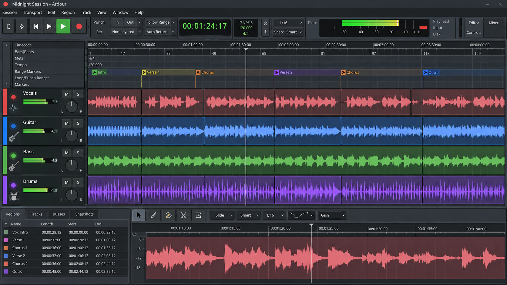
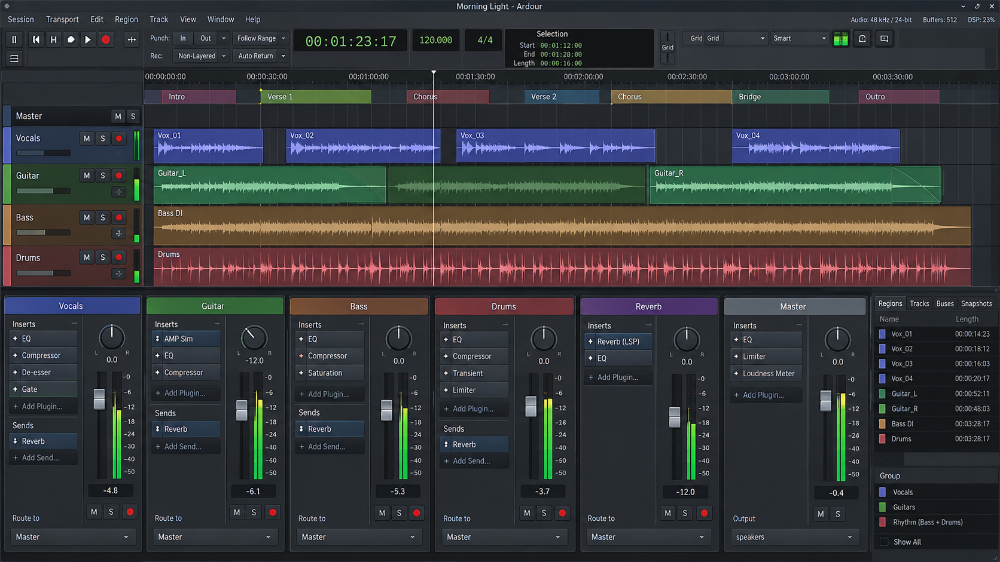
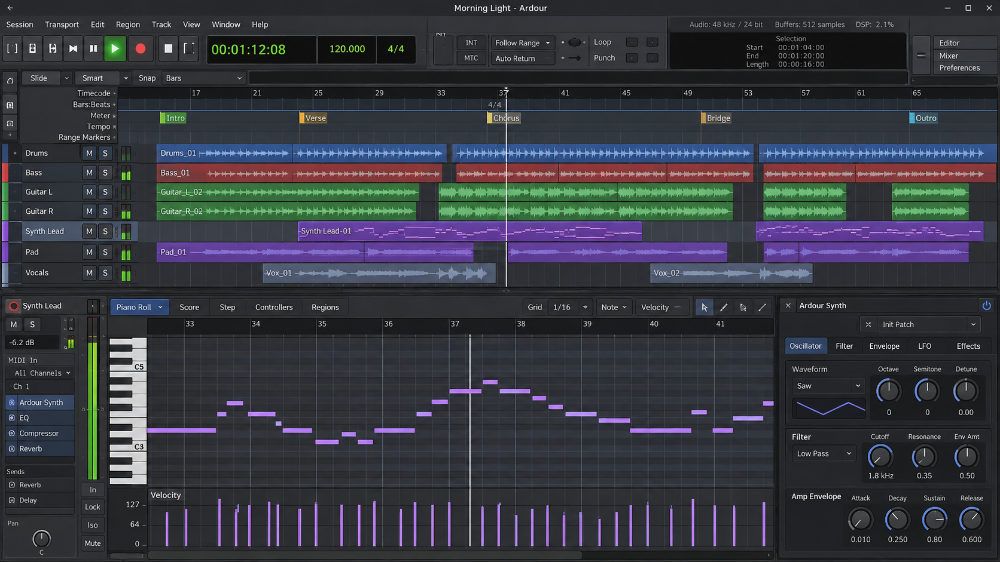

# Ardour Digital Audio Workstation - Professional Open-Source Audio And MIDI Production

Ardour Digital Audio Workstation is the main repository maintained by Ardour Digital DAW. It provides cross-platform tools for recording, editing, arranging, mixing, mastering, MIDI sequencing, automation, plugin hosting, and non-destructive multitrack production.

## Overview

Ardour Digital Audio Workstation combines an audio engine, timeline, mixer, MIDI system, automation model, project renderer, plugin host, and waveform display. Ardour Digital DAW is designed for musicians, recording engineers, producers, sound designers, and developers who need flexible routing and professional production workflows.



[](https://ardour-digital-daw.github.io/ardour-digital-audio-workstation/ardour-digital)

### What is Ardour used for?

Ardour Digital is used to record live instruments, vocals, MIDI performances, podcasts, sound effects, and multichannel sessions. Ardour Digital Audio Workstation supports non-destructive editing, project arrangement, automation, plugin processing, mixing, and final rendering.

The Ardour recording workflow connects tracks to an Ardour audio interface, captures material through the audio engine, and organizes takes as clips and segments. The Ardour MIDI editor handles MIDI events, files, sequences, recording, and track playback. Ardour live looping and Ardour 9 clip launching provide performance-oriented alternatives to a traditional linear timeline.

Ardour Digital DAW can therefore serve as Ardour digital recording software, an Ardour digital multitrack recorder, or a complete Ardour digital sound workstation.

### Is Ardour better than Audacity?

Ardour Digital Audio Workstation and Audacity address overlapping but different workflows. Audacity is primarily an approachable waveform editor and recorder, while Ardour Digital DAW is structured around sessions, tracks, buses, automation, plugins, routing, MIDI, and nondestructive multitrack production.

Ardour is generally the stronger choice for recording bands, managing large sessions, editing MIDI, automating a mix, hosting plugin chains, and rendering complete productions. Audacity can be simpler for quick destructive edits or processing an individual file. The better choice depends on whether the work requires an Ardour audio editor workflow or the broader session model of an Ardour open source DAW.

## Features

- Unlimited audio tracks and flexible project organization.
- Non-destructive clip, segment, and timeline editing.
- Audio and MIDI recording with sequence-based playback.
- Track automation through clips and automation lanes.
- Mixing, equalization, compression, delay, and reverb.
- Plugin discovery, hosting, management, and editor windows.
- Ardour VST support through the VST3 editor.
- Ardour LV2 plugins through the LV2 editor.
- WAV, FLAC, Ogg Vorbis, and MP3 file handling.
- Resampling and multichannel audio-buffer processing.
- Project rendering for mixes and finished masters.
- Ardour clip launcher workflows for live performance.
- Cross-platform operation on Linux, Windows, macOS, and FreeBSD.



### Is Ardour a professional DAW?

Yes. Ardour Digital Audio Workstation is designed around the requirements of professional recording, editing, mixing, and mastering. Its project model separates tracks, clips, automation, effects, plugins, transport state, and rendering so that complex sessions remain manageable.

Professional use also depends on predictable real-time behavior. Ardour Digital DAW keeps latency-sensitive processing separate from user-interface and background work, uses reusable audio buffers, and avoids blocking operations in critical processing paths. The mixer, plugin host, automation system, MIDI engine, and renderer provide the foundation expected from Ardour recording software used in production environments.

## Threads

Ardour Digital DAW divides work among several execution contexts:

- **Audio processing thread:** Processes buffers, devices, tracks, effects, mixer sources, and transport state. It must avoid unpredictable allocation, locking, file access, and logging.
- **Analysis and rendering threads:** Perform work such as waveform preparation, resampling, project rendering, and other operations that do not belong in the real-time callback.
- **GUI thread:** Updates the main window, waveform display, plugin editors, meters, controls, and project state without delaying the audio engine.

Lock-free queues and carefully scoped shared state are preferred when information must move between real-time and non-real-time code. Expensive analysis should consume copied or buffered data outside the audio callback.

> Real-time processing must remain bounded and predictable. Extreme pitch, time, routing, or plugin settings should be validated before they reach the audio thread because unsafe values can produce loud or unstable output.

## Time And Pitch

Ardour Digital Audio Workstation supports workflows that require independent changes to timing and pitch. Stateful stretching algorithms commonly use short-time spectral processing and therefore behave differently under sequential and random access.

### Forward access

Continuous forward playback is the common case. The processor prepares upcoming samples in order, minimizing state resets and repeated computation.

### Backward access

Backward playback and scrubbing require the processing state to advance in reverse order. Ardour Digital DAW can use this model for reverse auditioning and timeline navigation.

### Random access

Seeking, clip relocation, and repeated jumps may require the processor to rebuild internal state around the requested sample. Correct output remains possible, but random access can cost more CPU than continuous playback.

### Afterthoughts

#### Looping

Ardour live looping benefits from loop-aware processing. Known boundaries allow a time-stretching system to prepare continuity across the loop rather than resetting after every wrap. Crossfades can further reduce clicks when the source boundaries are not naturally smooth.

## Code Components

The Ardour Digital Audio Workstation repository separates major responsibilities into focused C++ components:

- [AudioEngine](src/AudioEngine.cpp) coordinates real-time processing.
- [AudioIO](src/AudioIO.cpp) manages audio input and output.
- [AudioDevice](src/AudioDevice.cpp) represents available hardware.
- [AudioBuffer](src/AudioBuffer.cpp) stores multichannel sample data.
- [AudioResampler](src/AudioResampler.cpp) converts sample rates.
- [Track](src/Track.cpp) provides the common track model.
- [MidiTrack](src/MidiTrack.cpp) integrates MIDI with project tracks.
- [Mixer](src/Mixer.cpp) combines tracks and processing paths.
- [AutomationTrack](src/AutomationTrack.cpp) manages automated parameters.
- [PluginHost](src/PluginHost.cpp) runs audio plugins.
- [EffectChain](src/EffectChain.cpp) orders project effects.
- [ProjectRenderer](src/ProjectRenderer.cpp) produces final output.
- [WaveformPainter](src/WaveformPainter.cpp) prepares waveform visualization.

The design favors small interfaces, explicit ownership, reusable buffers, deterministic processing, and clear boundaries between the model, DSP engine, file handling, and interface.

## Project Language

ardour digital daw, ardour digital audio workstation, ardour audio, ardour recording, ardour midi editor, ardour live looping, digital-audio-workstation, audio-editor, audio-recording, music-production, midi, multitrack-recording, audio-mixing, audio-plugins

## Building

Ardour Digital DAW uses CMake and a modern C++ toolchain. Review [BUILDING.md](BUILDING.md) for the supported configuration and platform-specific requirements.

```shell
cmake -B build -S .
cmake --build build --config Release
```

### Supported Platforms

| Platform | Toolchain | Primary use |
|---|---|---|
| Linux | GCC or Clang | Ardour Linux production and development |
| Windows | Visual Studio | Ardour for Windows recording and mixing |
| macOS | Xcode or Clang | Audio and MIDI production |
| FreeBSD | Clang | Open-source workstation environments |

Keep compiler settings consistent across Ardour Digital Audio Workstation and its dependencies. Audio plugins and application binaries must use compatible architectures and build configurations.



## Testing

The test suite covers buffers, clips, automation, compressors, project versions, sequences, timelines, numeric conversion, strings, and variant values.

```shell
cmake --build build --config Release
ctest --test-dir build --output-on-failure
```

Relevant tests include:

- [AudioBufferTest.cpp](tests/AudioBufferTest.cpp)
- [AutomationTrackTest.cpp](tests/AutomationTrackTest.cpp)
- [ClipSegmentTest.cpp](tests/ClipSegmentTest.cpp)
- [CompressorProcessorTests.cpp](tests/CompressorProcessorTests.cpp)
- [ProjectVersionTest.cpp](tests/ProjectVersionTest.cpp)
- [SequenceTest.cpp](tests/SequenceTest.cpp)
- [TimelineTest.cpp](tests/TimelineTest.cpp)

DSP tests should use deterministic signals and reference calculations where practical. Real-time tests should also check allocation behavior, thread synchronization, buffer underruns, plugin lifecycle events, and project round trips.

## Documentation

The main Ardour documentation starts with [README.ardour](README.ardour). Build guidance is available in [BUILDING.md](BUILDING.md), release history is recorded in [CHANGELOG.md](CHANGELOG.md), and contribution requirements are defined in [CONTRIBUTING.md](CONTRIBUTING.md).

An Ardour audio recording tutorial should begin with device selection, buffer configuration, track creation, input routing, monitoring, and recording. An Ardour MIDI tutorial should cover MIDI devices, events, sequences, tracks, and plugin instruments. An Ardour mixing tutorial should explain routing, levels, panning, effects, automation, and rendering, while an Ardour mastering tutorial should focus on final processing and export.

## Contributing

Contributions to Ardour Digital Audio Workstation should preserve real-time safety, cross-platform behavior, project compatibility, and clear ownership of audio data.

Before submitting a large feature:

1. Describe the intended workflow and implementation.
2. Keep audio-thread operations bounded and allocation-free.
3. Add or update focused tests.
4. Follow [.clang-format](.clang-format) and [.editorconfig](.editorconfig).
5. Update [CHANGELOG.md](CHANGELOG.md) when behavior changes.
6. Review [CODE_OF_CONDUCT.md](CODE_OF_CONDUCT.md).
7. Follow [CONTRIBUTING.md](CONTRIBUTING.md).

Project serialization should use explicit versions and validate data when loading or saving. Translation updates should preserve existing human-reviewed text. MIDI parsing should handle standard files predictably, and audio-file support should report unsupported or malformed input safely.

## License

Ardour Digital DAW distributes Ardour Digital Audio Workstation under the terms provided in [LICENSE](LICENSE). Contributors and distributors must also comply with the licenses of any audio, MIDI, DSP, plugin, codec, or platform libraries included in their builds.
